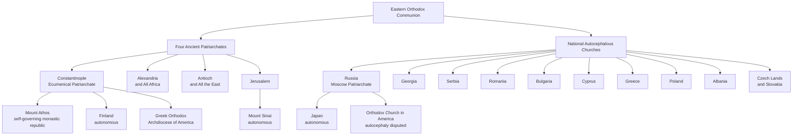

# The Eastern Orthodox Church: History, Theology, and Ecclesiological Structure

The **Eastern Orthodox Church** — also called the **Orthodox Catholic Church**, the **Orthodox Church**, or (in older Western usage) the **Eastern Church** (Greek: Ὀρθόδοξος Ἐκκλησία, _Orthodoxos Ekklēsia_) — is a communion of self-governing (_autocephalous_) local Churches that together form the second largest body of Christians in the world. Its member Churches are historically and sacramentally in full communion with one another, and they share a common Byzantine liturgical tradition, a patristic theological method, and a synodical canonical structure.

The communion is **not** a single centralized institution. It has no visible head analogous to the Roman Pontiff, no single canonical code, and no universal administrative jurisdiction above the local Church. Its unity is expressed Eucharistically — through concelebration, the commemoration of each Church's primate in the diptychs, and common participation in Pan-Orthodox assemblies.

---

## 1. Terminology: "Orthodox," "Eastern," and "Greek"

### 1.1 The Name

The word **Orthodox** (ὀρθός, _orthos_, "right, straight" + δόξα, _doxa_, "glory, opinion") signifies both right worship and right belief — the two are not separable in Eastern theology, where the rule of prayer (_lex orandi_) and the rule of faith (_lex credendi_) are held to interpret one another. The term came into established ecclesial use in the centuries after the Christological controversies, and it was fixed in common usage by the end of the first millennium.

### 1.2 "Eastern" and the Three Families of the Christian East

"Eastern" is a geographical and historical qualifier distinguishing this communion from the Latin West. It does not, however, identify the whole Christian East, which comprises **three distinct communions** that are not in full communion with one another:

| Communion                                                 | Christology                                                                       | Principal sees                                                                    | Communes with Eastern Orthodox? |
| --------------------------------------------------------- | --------------------------------------------------------------------------------- | --------------------------------------------------------------------------------- | ------------------------------- |
| **Eastern Orthodox**                                      | Chalcedonian: two natures in one Person                                           | Constantinople, Alexandria, Antioch, Jerusalem, Moscow, and the national Churches | —                               |
| **Oriental Orthodox**                                     | Non-Chalcedonian (miaphysite formulation: "one incarnate nature of God the Word") | Coptic, Syriac, Armenian Apostolic, Ethiopian, Eritrean, and Malankara Churches   | No                              |
| **Church of the East** (Assyrian and Chaldean; see below) | Antiochene, rejecting the Councils of Ephesus and Chalcedon as dogmatic           | Seleucia-Ctesiphon (historic), Baghdad, and the Chaldean Catholic Patriarchate    | No                              |

The **Oriental Orthodox** Churches separated after the Council of Chalcedon (451) and remain a distinct communion, though the modern Catholic–Oriental dialogue has clarified that much of the division rests on terminology rather than on the substance of the faith. The **Assyrian Church of the East** is documented separately in [assyrian-church-of-the-east.md](assyrian-church-of-the-east.md) and is not part of either Orthodox communion. The Catholic Church's own relations with all of these bodies, and with the Eastern Catholic Churches in full communion with Rome, are set out in [eastern-catholic-churches.md](eastern-catholic-churches.md) and [sects-and-non-christian-communities.md](sects-and-non-christian-communities.md).

### 1.3 "Greek Orthodox" — Three Senses

The adjective "Greek" is a persistent source of confusion and should be used with precision:

1. **Strictly historical**: the Greek-speaking Christian communities of the eastern Roman (Byzantine) Empire, and the jurisdictions that descend from them — the Ecumenical Patriarchate, the Greek Orthodox Patriarchates of Alexandria, Antioch, and Jerusalem, the Church of Greece, and the Church of Cyprus.
2. **Liturgically**: any jurisdiction that uses Greek as its liturgical or administrative language, or that follows the Byzantine (Constantinopolitan) liturgical tradition, including the Greek Orthodox Archdiocese of America and the Archdiocese of Australia.
3. **Loosely, in popular Western usage**: any Eastern Orthodox Christian whatsoever. It is common in the English-speaking world to speak of "the Greek Orthodox church" in a town where the parish is in fact Antiochian, Serbian, Romanian, or Russian.

**Sense 3 is imprecise and should be avoided in formal writing.** This document therefore treats the whole communion, and reserves "Greek Orthodox" for the jurisdictions in senses 1 and 2.

---

## 2. Historical Origins and Development

### 2.1 The Ancient Pentarchy

During the first millennium, ecclesiastical administration coalesced around the great apostolic sees. The Emperor Justinian I (r. 527–565) gave juridical form to the **Pentarchy** — the five patriarchates of **Rome, Constantinople, Alexandria, Antioch, and Jerusalem** — under the title "Most holy Patriarchs of the Oikoumene." In the East, the Emperor was to convoke an ecumenical council when the patriarchs fell into serious disagreement.

Constantinople, founded as "New Rome" in 330, rose rapidly in precedence: the Council of Constantinople I (381) ranked it second after Rome, and the Council of Chalcedon (451) granted its bishop the title of **Ecumenical Patriarch**. The Pentarchy suffered its first reversal when the Churches that did not accept Ephesus (431) and Chalcedon (451) separated; it was further disordered by the division of the empire at the crowning of Charlemagne (800), and it effectively ended with the fall of Constantinople in 1453.

### 2.2 The Great Schism of 1054

Tensions between the Latin-speaking West and the Greek-speaking East accumulated over centuries: linguistic divergence, the Frankish reshaping of Western theology, the _Filioque_ addition to the Creed, the use of unleavened bread (_azyma_) in the Latin Eucharist, and — decisively — divergent understandings of Roman primacy. The East maintained a collegiate model in which the Bishop of Rome held a primacy of honor among the patriarchs; the West, particularly after the Gregorian Reform, asserted a universal, ordinary, and immediate jurisdiction.

In July 1054, Cardinal Humbert of Silva Candida laid a bull of excommunication on the altar of Hagia Sophia, and Patriarch Michael I Cerularius responded by excommunicating the legates. The events of 1054 were not in themselves a total rupture — communion was still imperfectly maintained in places for decades — but they became the symbolic and canonical marker of the **Great Schism**, whose definitive consolidation came with the sack of Constantinople in the Fourth Crusade (1204) and the repeated failure of the union councils of Lyon II (1274) and Florence (1439).

### 2.3 The Byzantine Commonwealth and the Slavic Mission

The Orthodox world was never confined to Greek-speaking peoples. The mission of **Saints Cyril and Methodius** to Great Moravia (863) produced the Glagolitic alphabet, its successor the **Cyrillic** script, and a Slavonic liturgical language, and it planted the seeds of a Slavic Orthodox civilization that would eventually outweigh the Greek churches in numbers.

The **Baptism of Rus'** under Saint Vladimir of Kiev (988) brought the East Slavs into the Constantinopolitan orbit. The metropolitan see of Kiev — canonically under Constantinople — was transferred to Vladimir and then, in 1325, to **Moscow**. The Union of Florence (1439) was repudiated in Moscow, and in **1448** the Russian bishops elected Saint Jonah as metropolitan without reference to Constantinople: the practical beginning of Russian autocephaly. In **1589**, Patriarch Jeremiah II of Constantinople raised the Metropolitan of Moscow to the rank of patriarch, and the synods of 1590 and 1593 proclaimed him the equal in rank of the ancient patriarchs. The ideology of Moscow as the "Third Rome" — the last Orthodox empire after the fall of Constantinople — followed, and it has never ceased to shape Russian ecclesial self-understanding.

The patriarchate was **abolished by Peter the Great in 1721** and replaced by the Holy Governing Synod, an imperial department; the patriarchate was restored only in 1917, on the eve of the Bolshevik revolution.

### 2.4 Ottoman Rule and the Rum Millet

With the fall of Constantinople in 1453, the Ottoman sultans organized Orthodox Christians into the **Rum Millet** ("the Roman nation"), making the Ecumenical Patriarch both the spiritual head and the civil magistrate (_ethnarch_) of Orthodox subjects of the empire. This preserved the Church under Islamic rule, but it fused ethnic and ecclesial identity, and it made the Patriarchate an instrument of Ottoman administration — a burden from which its authority never fully recovered.

### 2.5 National Autocephaly, 1833–1998

Nationalism broke the Patriarchate's effective control over the Balkans and Eastern Europe. The pattern was set in **1833**, when the bishops of the newly independent Greek kingdom declared the Church of Greece independent of Constantinople; the Ecumenical Patriarchate recognized the status in **1850**. Bulgaria followed in 1870 (with a Greek-imposed schism that lasted until 1945), Serbia in 1879, Romania in 1885 (patriarchate 1925), Albania in 1937, Georgia in 1917 (recognized by Moscow in 1943), Poland in 1924, and the Czech Lands and Slovakia in 1951 and again, definitively, in 1998.

The pattern is normative in Orthodox canon law as it is actually practised: **autocephaly has ordinarily followed political independence**, and the granting mother Church issues a _tomos_ (a patriarchal act of canonical erection) confirming the new Church's self-governance.

### 2.6 The Twentieth Century and After

The twentieth century reshaped the communion:

- **Persecution.** The Russian Church suffered catastrophic persecution under the Soviet regime — tens of thousands of clergy and monastics killed, parishes destroyed, and the patriarchal structure reduced to a instrument of state control. Similar, if less total, persecution occurred across the Soviet bloc.
- **Diaspora.** Emigration created large Orthodox populations in Western Europe, the Americas, and Australia, organized — anomalously — along ethnic lines rather than territorial ones.
- **Jurisdictional realignments.** The **Russian Orthodox Church Outside Russia (ROCOR)**, founded in 1920 by exiled hierarchs, remained separated from Moscow until its canonical reunion in **2007**. The **Orthodox Church in America (OCA)** received autocephaly from Moscow in **1970**; that status is recognized by Moscow and several other Churches, but not by Constantinople or the Greek-speaking patriarchates.
- **The Council of Crete (2016).** The Holy and Great Council convened in Crete in June 2016 — the first assembly of its kind in over a millennium. Four Churches (Antioch, Russia, Bulgaria, and Georgia) did not attend, and the Council's documents have not been received uniformly, which limits its weight as a genuinely pan-Orthodox event.
- **Ukraine (2018–present).** In October 2018 the Ecumenical Patriarchate revoked the 1686 act by which the Kyivan metropolitanate had been transferred to Moscow, and in January 2019 it granted a _tomos_ of autocephaly to the newly unified **Orthodox Church of Ukraine**. Moscow denounced the act, **broke communion with Constantinople**, and the resulting schism remains the gravest open division in world Orthodoxy. In May 2022, amid the war in Ukraine, the Ukrainian Orthodox Church (Moscow Patriarchate) declared its independence from Moscow.

---

## 3. Theological and Ecclesiological Foundations

### 3.1 Sources and Method

Orthodox theology is **patristic** in method and **liturgical** in its primary locus. It appeals to the faith "once for all delivered to the saints" (Jude 1:3), and it treats the consent of the Fathers (_consensus Patrum_), the definitions of the ecumenical councils, and the Church's worship as mutually interpreting witnesses to a single Tradition. Scripture is read within that Tradition, not against it.

Two features distinguish the method from the Latin scholastic tradition: a preference for **apophatic** (negative) theology, which denies that creaturely concepts can capture God's essence; and a strong emphasis on **reception** — a council's authority is confirmed not by its convocation alone but by its reception in the whole Church.

### 3.2 Synodical Ecclesiology

Orthodoxy is organized not around a single supreme visible head but around a **synodical (conciliar) model**:

- **Communion of sister Churches.** Every autocephalous Church is headed by its own synod of bishops and its own patriarch, archbishop, or metropolitan, and elects its own primate.
- **Primacy of honor.** The Ecumenical Patriarch of Constantinople holds the first place in order and honor among the patriarchates and autocephalous Churches. He convenes Pan-Orthodox assemblies and enjoys historic prerogatives; he does not possess universal administrative jurisdiction, and he is not held to be infallible apart from the Church.
- **Infallibility of the Church.** Dogmatic infallibility is located not in any single bishop but in the whole Church, expressed through the ecumenical councils and received in the consensus of the faithful.

### 3.3 The Seven Ecumenical Councils

Orthodox theology is anchored in the **Seven Ecumenical Councils**, held between 325 and 787 — and in no later council, which is why the Orthodox do not receive the fourteen councils reckoned by the Latin Church after 787:

1. **Nicaea I (325)** — the divinity of the Son; the original Nicene Creed, against Arianism.
2. **Constantinople I (381)** — the divinity of the Holy Spirit; the completion of the Creed.
3. **Ephesus (431)** — the title _Theotokos_ for the Blessed Virgin, against Nestorianism.
4. **Chalcedon (451)** — two complete natures, divine and human, in the one Person of Christ.
5. **Constantinople II (553)** — the reaffirmation of Chalcedonian Christology and the condemnation of the Three Chapters.
6. **Constantinople III (680–681)** — two wills and two energies in Christ, against Monothelitism.
7. **Nicaea II (787)** — the defeat of Iconoclasm; the veneration (_proskynesis_) of icons, distinguished from the worship (_latreia_) due to God alone.

### 3.4 Essence and Energies, Hesychasm, and Theosis

A defining feature of Orthodox theology is the distinction between God's **essence** (_ousia_) and His **energies** (_energeiai_), given systematic form by **Saint Gregory Palamas** in the fourteenth century and vindicated by the councils of Constantinople in 1341–1351:

- **Essence**: God's inner nature is wholly transcendent and inaccessible to creatures.
- **Energies**: God's uncreated operations are truly communicated to creation. Through them, human beings are made "partakers of the divine nature" (2 Peter 1:4).
- **Theosis** (deification): the goal of the Christian life — not the absorption of the creature into the divine essence, but real participation in the divine life by grace.
- **Hesychasm**: the tradition of silent contemplative prayer centred on the **Jesus Prayer** ("Lord Jesus Christ, Son of God, have mercy on me, a sinner"), associated with the experience of the uncreated Light of Tabor.

---

## 4. Structural Organization and Jurisdictions

### 4.1 Autocephaly and Autonomy

The _Encyclopedic Dictionary of the Christian East_ defines **autocephaly** (from αὐτοκέφαλος, "self-headed") as "a system of ecclesiastical administration proper to Orthodox Churches following norms of Byzantine civil administration," which "guarantees each national Church full internal administrative autonomy under the direction of a patriarch, archbishop or metropolitan as well as the ability to choose its own bishops, including the patriarch, archbishop or metropolitan who heads the Church." Unity with the rest of Orthodoxy is expressed "in the eucharistic celebration, the enrolment of the heads of the other Churches in the diptychs, and in Pan-Orthodox assemblies," and "the Patriarchate of Constantinople holds the first place in order and in honour among all the patriarchates and autocephalous Churches" ([Magisterium, _Autocephaly_](https://www.magisterium.com/docs/2cb86786-6b8e-4ddd-b5fe-d1ebaccb869c/ref/Autocephaly)).

**Autonomy** is a lesser status: the Church elects its own bishops and governs its internal life, but its head is confirmed by, and commemorates, a mother Church.

The same source notes that "currently, fourteen autocephalous and autonomous Orthodox Churches are officially recognized in the Orthodox Church," and that "there are also Churches concerning whose status there is no consensus, since the canon law which applies is unclear."

### 4.2 The Fourteen Autocephalous Churches

| #   | Church                                                   | See        | Notes                                                                                                                      |
| --- | -------------------------------------------------------- | ---------- | -------------------------------------------------------------------------------------------------------------------------- |
| 1   | Ecumenical Patriarchate of Constantinople                | Istanbul   | Primacy of honor; oversees Mount Athos, Finland, Crete, and the Greek diaspora archdioceses                                |
| 2   | Greek Orthodox Patriarchate of Alexandria and All Africa | Alexandria | Canonical jurisdiction over the whole continent of Africa; extensive missionary work                                       |
| 3   | Greek Orthodox Patriarchate of Antioch and All the East  | Damascus   | Greek in liturgical heritage, now predominantly Arabic-speaking in its home territory                                      |
| 4   | Greek Orthodox Patriarchate of Jerusalem                 | Jerusalem  | "Mother of all Churches"; custodian of the Holy Sepulchre; Greek hierarchy with a predominantly Arab faithful              |
| 5   | Russian Orthodox Church (Moscow Patriarchate)            | Moscow     | The largest Orthodox Church; _de facto_ autocephaly 1448, patriarchate 1589; oversees Japan and the former Chinese mission |
| 6   | Georgian Orthodox Church                                 | Tbilisi    | Ancient Catholicosate; autocephaly declared 1917, recognized by Moscow 1943                                                |
| 7   | Serbian Orthodox Church                                  | Belgrade   | Autocephaly 1879; patriarchate 1920                                                                                        |
| 8   | Romanian Orthodox Church                                 | Bucharest  | Autocephaly 1885; patriarchate 1925; the second largest Orthodox Church                                                    |
| 9   | Bulgarian Orthodox Church                                | Sofia      | Autocephaly 1870, recognized 1945                                                                                          |
| 10  | Church of Cyprus                                         | Nicosia    | Autocephalous since the Council of Ephesus (431), canon 8 — the oldest autocephaly                                         |
| 11  | Church of Greece                                         | Athens     | Declared independent 1833; recognized by Constantinople 1850                                                               |
| 12  | Polish Orthodox Church                                   | Warsaw     | Autocephaly 1924                                                                                                           |
| 13  | Orthodox Autocephalous Church of Albania                 | Tirana     | Autocephaly 1937                                                                                                           |
| 14  | Orthodox Church of the Czech Lands and Slovakia          | Prague     | Autocephaly 1951; final settlement 1998                                                                                    |

**Autonomous bodies** include **Mount Athos** (a self-governing monastic republic under the spiritual jurisdiction of Constantinople), the **Church of Sinai** (under Jerusalem), the **Orthodox Church of Finland** (under Constantinople, 1923), and the **Japanese Orthodox Church** (under Moscow, 1970). The **Orthodox Church in America**, autocephalous by grant of Moscow in 1970, remains unrecognized as such by Constantinople and several other Churches.

### 4.3 The Four Ancient Patriarchates

1. **Ecumenical Patriarchate of Constantinople** (Istanbul). The historic mother Church of the Byzantine world and the first see of Orthodoxy in honor. It directly governs the Orthodox of Turkey, the Aegean islands, Mount Athos, Crete, Finland, and the large Greek-speaking diaspora archdioceses — including the **Greek Orthodox Archdiocese of America** and the **Greek Orthodox Archdiocese of Australia**.
2. **Greek Orthodox Patriarchate of Alexandria and All Africa.** Jurisdiction over the entire African continent, with a historic Greek hierarchy and rapidly growing indigenous clergy and faithful in sub-Saharan Africa.
3. **Greek Orthodox Patriarchate of Antioch and All the East** (Damascus). The see of Saint Peter before Rome; historically Greek and West Syrian, its life and liturgy are now predominantly Arabic. It is the largest Orthodox body in the Levant.
4. **Greek Orthodox Patriarchate of Jerusalem.** The "Mother of all Churches," guardian of the Holy Sepulchre, Bethlehem, and the Jordan, and a party — with the Latin Custody and the Armenian Patriarchate — to the centuries-old **Status Quo** governing the holy places.

### 4.4 The National Churches

The remaining ten autocephalous Churches are, in origin, national or regional bodies whose autocephaly followed political independence (see §2.5). The **Russian Orthodox Church** is by far the largest, numbering well over a hundred million adherents, and it exercises a decisive weight in inter-Orthodox affairs — a weight that the 2018 Ukraine crisis has made explicit.

### 4.5 The Diaspora and Unresolved Jurisdictions

The most serious structural weakness of the communion is the **Orthodox diaspora**. The ancient canon of one bishop in one city has been displaced in Western Europe, the Americas, and Australia by a patchwork of overlapping ethnic jurisdictions — Greek, Russian, Serbian, Romanian, Antiochian, Bulgarian, and others — each with its own bishop in the same territory. Repeated Pan-Orthodox consultations have failed to resolve the problem, and it has been compounded by the disputes over Estonia, Ukraine, and the OCA.

---

## 5. Two Great Families: Greek and Russian Orthodoxy

The two largest cultural families within the communion are the Greek and the Russian. They are **not two denominations**: they share one faith, one baptism, one Eucharist, and are in full communion. They are two autocephalous Churches — indeed, two clusters of them — with distinct languages, calendars, chant, iconography, and political histories, and each is governed by its own patriarch and synod.

| Feature             | Greek Orthodox tradition                                                                                       | Russian Orthodox tradition                                                    |
| ------------------- | -------------------------------------------------------------------------------------------------------------- | ----------------------------------------------------------------------------- |
| Head                | Ecumenical Patriarch Bartholomew I (Constantinople), with the Patriarchs of Alexandria, Antioch, and Jerusalem | Patriarch Kirill of Moscow and All Rus'                                       |
| Liturgical language | Koine Greek (vernacular in the diaspora)                                                                       | Church Slavonic                                                               |
| Calendar            | Revised Julian: fixed feasts on the Gregorian date, so **Nativity on 25 December**                             | Julian: fixed feasts thirteen days later, so **Nativity on 7 January**        |
| Paschal computus    | Julian paschalion                                                                                              | Julian paschalion                                                             |
| Chant               | Byzantine chant                                                                                                | Znamenny, Obikhod, and the later synodal harmonizations                       |
| Iconography         | Byzantine style                                                                                                | Novgorod, Muscovite, and Stroganov schools                                    |
| Monastic centre     | Mount Athos                                                                                                    | Trinity-Sergius Lavra, Optina, Valaam, Pochaev, Kyiv Caves                    |
| Church and state    | Ottoman _millet_, then national synodal Churches                                                               | _Symphonia_; the Synodal period (1721–1917); enduring close ties to the state |
| Diaspora            | Greek Orthodox Archdiocese of America (Constantinople)                                                         | ROCOR (reunited with Moscow 2007); OCA (autocephaly 1970, disputed)           |
| Governance          | Ecumenical Patriarchate plus the other ancient patriarchates, Greece, and Cyprus                               | Patriarch of Moscow, Holy Synod, Bishops' Council, and Local Council          |

The practical differences that most often puzzle Western observers follow from this table: why a Russian parish keeps Christmas in January and a Greek parish does not; why the music sounds entirely different in the two temples; why the Russian Church speaks with a single centralized voice while the Greek-speaking world speaks with several; and why the two hierarchies have been at odds since 2018 over Ukraine.

---

## 6. Liturgical and Sacramental Traditions

### 6.1 The Byzantine Liturgical Tradition

All Eastern Orthodox Churches descend, liturgically, from the rite of Constantinople. The **Divine Liturgy** is normally that of **Saint John Chrysostom**, with the longer Liturgy of **Saint Basil the Great** celebrated ten times a year (the Sundays of Great Lent, Holy Thursday and Saturday, the vigils of Nativity and Theophany, and the feast of Saint Basil). The Liturgy of the Presanctified Gifts, attributed to Saint Gregory the Dialogist, is served on the weekdays of Great Lent.

The liturgical year begins on 1 September and is organized around **Pascha**, the feast of feasts, computed by the Julian paschalion (the autonomous Church of Finland is the exception, using the Gregorian date).

### 6.2 Languages of Worship

Orthodoxy has never imposed a single liturgical language. The communion worships in **Greek, Church Slavonic, Romanian, Georgian, Arabic, Serbian, Bulgarian, Albanian, Finnish, Estonian, English, French, Spanish, Japanese, Korean, Swahili, Yup'ik**, and many others. This multiplicity is the enduring fruit of the Cyrillo-Methodian principle that every people should hear the Gospel in its own tongue.

### 6.3 Sacred Art and Chant

Churches are ordered around the **iconostasis**, the icon screen separating the nave from the sanctuary, and adorned with frescoes and icons understood as "windows into heaven." Icons are venerated with incense and kisses, not worshipped — the distinction between _proskynesis_ and _latreia_ defined at Nicaea II (787). Music is **unaccompanied vocal chant**: Byzantine chant in the Greek tradition, Znamenny and Obikhod chant in the Russian, and a rich family of Georgian, Romanian, Serbian, and Bulgarian traditions besides.

### 6.4 The Holy Mysteries

Orthodox theology calls the sacraments the **Holy Mysteries**, and administers them with several notable differences from Latin practice:

- **Initiation.** Infant baptism by **triple immersion**, immediately followed by **chrismation** with Holy Myron and by **Holy Communion** — the ancient unity of the three sacraments of initiation is preserved. Chrismation is normally conferred by the priest, using chrism consecrated by the primate.
- **The Eucharist.** Leavened wheat bread (_artos_) and wine, with warm water (_zeon_) added in Greek practice; communion is given from the chalice with a spoon, and infants and small children communicate.
- **Marriage.** The Service of Betrothal and the Service of Crowning. Marriage is taught to be indissoluble, but pastoral **_oikonomia_** (economy) permits ecclesiastical divorce and a second, or in some cases a third, marriage, usually with penitential rites.
- **Orders.** Married men may be ordained deacons and priests; bishops are chosen from the celibate — in practice monastic — clergy; a priest may not marry after ordination or remarry if widowed.
- **Anointing of the Sick.** Oil blessed by a priest or bishop, administered in the Mystery of Holy Unction, often by a college of seven priests.
- **Repentance.** Confession before a confessor, normally with a spiritual father, and a penance given as healing discipline rather than as satisfaction of a penalty.

Fasting is extensive: Wednesdays and Fridays throughout the year, together with four penitential seasons — Great Lent, the Nativity Fast, the Apostles' Fast, and the Dormition Fast. Parish practice varies considerably in strictness.

---

## 7. Theological Comparison: Eastern Orthodoxy and Roman Catholicism

The two communions share the same first-millennium heritage, valid apostolic succession, valid sacraments, and a common faith in the Trinity, the Incarnation, and the Real Presence. The Second Vatican Council acknowledged this explicitly: the Eastern Churches "although separated from us, yet possess true sacraments and above all, by apostolic succession, the priesthood and the Eucharist, whereby they are linked with us in closest intimacy" (_Unitatis Redintegratio_ 15). The remaining differences are of very uneven weight, and the table below marks them accordingly.

| Doctrine or Practice          | Eastern Orthodox                                                                                                                                                    | Roman Catholic                                                                                                                                     | Level of Difference                              |
| ----------------------------- | ------------------------------------------------------------------------------------------------------------------------------------------------------------------- | -------------------------------------------------------------------------------------------------------------------------------------------------- | ------------------------------------------------ |
| **Primacy and jurisdiction**  | Primacy of honor among equals; no universal, ordinary jurisdiction over other Churches                                                                              | Universal, ordinary, and immediate jurisdiction of the Pope (_Pastor Aeternus_, 1870)                                                              | Ecclesiology and canon law                       |
| **Infallibility**             | Located in the whole Church, expressed in ecumenical councils received by the faithful                                                                              | Personal infallibility of the Pope when teaching _ex cathedra_ on faith or morals                                                                  | Dogma, as defined in the West                    |
| **The Creed**                 | The Creed without the _Filioque_; the procession "from the Father"                                                                                                  | The _Filioque_ ("and the Son"), professed as dogma since the thirteenth century                                                                    | Dogma in the West; canonical legitimacy disputed |
| **Grace and deification**     | Uncreated divine energies really communicated; _theosis_ as the goal of the Christian life                                                                          | Sanctifying grace as a created quality of the soul; the beatific vision through the _lumen gloriae_                                                | Theological tradition, not defined dogma         |
| **Ancestral sin**             | The inheritance of mortality and a wounded nature; no inheritance of personal guilt                                                                                 | Original sin as the privation of original holiness and justice — a state, not an inherited personal guilt (CCC 404–405)                            | Doctrine, differently formulated                 |
| **The Immaculate Conception** | Not received; the Theotokos is _Panagia_, all-holy, but the 1854 definition is rejected                                                                             | Defined dogma (1854): preserved immune from all stain of original sin from the first moment of her conception                                      | Dogma in the West                                |
| **The Dormition**             | The Dormition and bodily glorification of the Theotokos are believed and celebrated (15 August) but not defined in the Latin terms                                  | Defined dogma (1950) of the bodily Assumption                                                                                                      | Doctrine, differently defined                    |
| **Purgatory**                 | An intermediate state of purification and growth is affirmed and prayer for the dead practised; the defined Latin doctrine of purgatory as satisfaction is rejected | Defined dogma: a final purification of the elect, with temporal punishment remitted through satisfaction, suffrage, and indulgence (CCC 1030–1032) | Doctrine, differently formulated                 |
| **Indulgences**               | Not practised; no doctrine of the treasury of merit                                                                                                                 | Doctrine and Latin discipline                                                                                                                      | Doctrine and discipline                          |
| **Eucharistic bread**         | Leavened bread (_artos_), with _zeon_                                                                                                                               | Unleavened bread in the Latin Rite (Eastern Catholic Churches use leavened bread)                                                                  | Discipline                                       |
| **Sacraments of initiation**  | Baptism, chrismation, and Eucharist administered together, including to infants                                                                                     | Latin discipline separates them; first Communion at the age of reason                                                                              | Discipline                                       |
| **Marriage**                  | Indissolubility taught, with _oikonomia_ permitting up to three marriages                                                                                           | Absolute indissolubility of a consummated sacramental marriage; declarations of nullity instead of divorce                                         | Discipline with doctrinal implications           |
| **Clerical celibacy**         | Married priests and deacons; bishops from the celibate or monastic clergy                                                                                           | Celibate priesthood in the Latin Church (with limited exceptions); married priests in the Eastern Catholic Churches                                | Discipline                                       |
| **Ecumenical councils**       | Seven                                                                                                                                                               | Twenty-one                                                                                                                                         | Canonical and theological                        |

---

## 8. Ecumenical Dialogue and Catholic–Orthodox Relations

### 8.1 The Lifting of the Anathemas (1965)

On 7 December 1965, at the close of the Second Vatican Council, Pope Saint Paul VI and Ecumenical Patriarch Athenagoras I issued a joint declaration **retracting and erasing from memory** the mutual excommunications of 1054, lamenting "the offensive words, the groundless reproaches, and the untoward gestures" that had accompanied the rupture, and committing both Churches to a dialogue of charity. (For the succession of pontiffs involved, see [papal-chronology.md](papal-chronology.md).)

### 8.2 The Dialogue of Truth

The **Joint International Commission for Theological Dialogue between the Catholic Church and the Orthodox Church** was established in 1979 and has produced a series of agreed statements:

- The **Munich Document (1982)** — on the relation of the Church to the Eucharist.
- The **Balamand Declaration (1993)** — rejecting "uniatism" as a method of seeking unity while affirming the legitimacy of the existing Eastern Catholic Churches (see [eastern-catholic-churches.md](eastern-catholic-churches.md)).
- The **Ravenna Document (2007)** — agreeing that in the first millennium the Bishop of Rome was recognized as the first (_protos_) among the patriarchs, while leaving open how that primacy would be exercised in a reunited Church.
- The **Chieti Document (2016)** and the **Alexandria Document (2023)** — continuing the study of synodality and primacy in the first millennium.

### 8.3 Remaining Obstacles

Three obstacles remain decisive. **First**, the theology and practice of primacy: the Ravenna–Chieti trajectory has narrowed the question but has not answered it, and any answer must reckon with the Orthodox conviction that the first millennium knew no universal ordinary jurisdiction. **Second**, the **Eastern Catholic Churches**, whose very existence the Orthodox side regards as the residue of uniatism, notwithstanding the Balamand repudiation of uniatism as a method. **Third**, the **canonical disputes within Orthodoxy itself** — the diaspora, the OCA, and above all Ukraine — which make it impossible to speak of "the Orthodox Church" as a single negotiating partner.

The historical memory of the Fourth Crusade's sack of Constantinople (1204) continues to weigh on Orthodox sensibilities, and was invoked by Patriarch Bartholomew in accepting Pope Francis' expressions of regret. Against these obstacles stands a genuine and growing convergence on the sacraments, the ministry, and the Theotokos — and a shared conviction that the division of 1054 is a wound in the one Body of Christ.

---

## See Also

- [eastern-catholic-churches.md](eastern-catholic-churches.md) — The twenty-three Eastern Catholic _sui iuris_ Churches and their relations with Rome.
- [orthodox-east-and-the-reformation.md](orthodox-east-and-the-reformation.md) — Why the Orthodox East did not undergo a Protestant-style Reformation, with comparative Catholic–Orthodox demographics from 1054 to the present.
- [assyrian-church-of-the-east.md](assyrian-church-of-the-east.md) — The third great tradition of the Christian East, distinct from both the Eastern and Oriental Orthodox.
- [sects-and-non-christian-communities.md](sects-and-non-christian-communities.md) — The Magisterial classification of particular Churches separated from Rome.
- [protestant-reformation.md](protestant-reformation.md) — The Western Reformation and the Catholic response.
- [church-hierarchy.md](church-hierarchy.md) — The hierarchy of order and jurisdiction, East and West.
- [papal-chronology.md](papal-chronology.md) — The chronological list of the Roman pontiffs.
